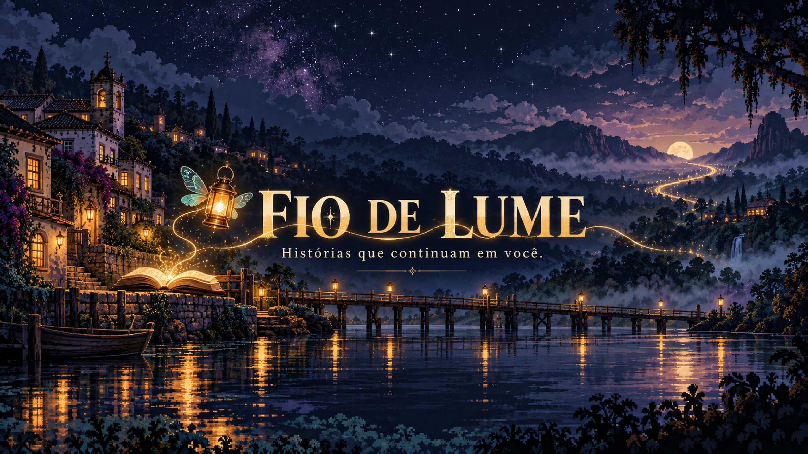

# Fio de Lume



**Histórias que continuam em você.**

Canal de Emanuel Bonfim para histórias narradas em português brasileiro:
mistérios, dramas humanos, encontros inesperados e reviravoltas. Cada história se divide em três ou quatro partes, com um vídeo por parte,
narrador masculino, linguagem atual, pixel art animada e ganchos em todos os encerramentos.

**Repositório oficial:** `emanoelb5-lgtm/Cala-YouTube-solo-de-hist-rias`.

## O canal

| Elemento | Definição |
| --- | --- |
| Nome | **Fio de Lume** |
| Frase | **Histórias que continuam em você.** |
| Linha principal | Ficção original de mistério, emoção, escolhas e reviravoltas |
| Outras séries | Relatos reais e históricos, com fontes e identificação |
| Voz | **Antonio**, narrador masculino brasileiro; gravação de Emanuel quando enviada |
| Mascote | **Lume**, pequena lanterna voadora com asas verde água |
| Identidade | Azul de tinta, dourado antigo, pergaminho e ameixa |
| Vídeos | Próximos de oito minutos, Full HD, horizontal **16:9**, **24 fps** |
| Legendas | Sem transcrição na tela por padrão; SRT separado e opcional |

[Descrição pronta para copiar](docs/descricao-do-canal.txt) ·
[Identidade e proposta](docs/canal.md) ·
[Como serão os vídeos](docs/como-serao-os-videos.md) ·
[Artes do canal](docs/identidade/README.md) ·
[Primeiras histórias](docs/pautas.md)

## Como pedir o próximo vídeo

> Faça o próximo vídeo do Fio de Lume, escolha uma história e entregue no
> repositório Cala-YouTube-solo-de-hist-rias com os materiais para publicar.

Também é possível indicar uma história, gênero ou narração gravada. O pedido
no chat inicia a produção completa. Emanuel faz a publicação no YouTube.

## Base copiada e adaptada

O projeto parte dos utilitários de narração, montagem, preparação e conferência
do Quase Infinito. A configuração, a identidade, os modelos e as regras foram
adaptados para narrativa. A origem está registrada em
[Procedência da cópia](docs/origem-da-copia.md).

## Preparação técnica

Python 3.12, FFmpeg/ffprobe e fonte DejaVu Sans são usados na montagem. A
narração usa edge-tts e precisa de internet. A disponibilidade da voz é
conferida durante cada produção; o roteiro é escrito no chat.

```bash
python -m pip install -r requirements-production.txt
python scripts/check_setup.py
python scripts/new_episode.py --slug h001-p01-injustica --title "O funcionário que eles tentaram apagar"
```

Preencha roteiro, personagens, metadados e cenas no novo episódio; produza os
assets antes de montar. O modelo tem campos vazios para evitar tratar um
rascunho como uma entrega.

```bash
python scripts/generate_narration.py --text-file videos/h001-p01-injustica/narracao.txt --output-dir work/h001-p01-injustica
python scripts/assemble_video.py --episode videos/h001-p01-injustica --work-dir work/h001-p01-injustica
python scripts/prepare_delivery.py --episode videos/h001-p01-injustica --work-dir work/h001-p01-injustica
python scripts/package_episode.py --episode videos/h001-p01-injustica
```

A duração e os planos devem seguir os tempos reais da narração. O compositor
aceita imagens com movimento, clips animados e filmagens; animações de
personagens e parallax são preparados por cena e fornecidos como clips.

## Entrega por episódio

MP4 separado, miniatura PNG/JPG, título e descrição em TXT, metadados, roteiro,
narração, fontes/créditos, SRT quando disponível, relatório técnico e ZIP de
publicação. O pacote é criado somente depois de validar arquivos reais.
A conferência técnica não substitui assistir ao vídeo inteiro.

[Episódios](videos/README.md) · [Modelo de episódio](templates/episodio/README.md)

A primeira parte da história ativa está produzida. O vídeo, a miniatura e os materiais estão em [Parte 1 — O culpado perfeito](videos/h001-p01-injustica/README.md).

## Diretrizes atuais e primeira história ativa

Linguagem contemporânea e acessível, narrador masculino e histórias instigantes em três ou quatro partes. Cada parte termina com um gancho; a última resolve o conflito antes de abrir uma possibilidade de futuro.

**O funcionário que eles tentaram apagar** está estruturada em quatro partes. [Plano editorial](historias/h001-o-funcionario/plano-editorial.md) · [Roteiro da parte 1](historias/h001-o-funcionario/narracao-parte-01.txt) · [Diretrizes](docs/diretrizes-do-canal.md). **A parte 1 foi produzida em pixel art animada, com narração masculina, 8min26s e Full HD.** [Entrega da parte 1](videos/h001-p01-injustica/README.md). A série anterior da carta está abandonada.
